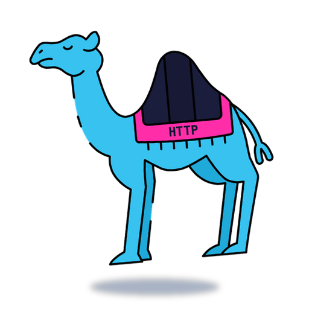

# httpcamels

An HTTP codes API as an OCaml unikernel.

<p align="center">
  
</p>

## Usage

### Requirements

Install opam dependencies with:

```shell
opam install mirage.4.11.2 opam-monorepo.0.4.3 brr.0.0.9
```

### Build and run the unikernel

```shell
make                # Uses the Unix target by default
./dist/httpcamels
```

> [!NOTE]
> In Unix target, if there is no **tap** device (`tap0` specifically), or the unikernel can't open one, it won't start. You can use the host's sockets with ([checkout MirageOS docs](https://mirage.io/docs/hello-world)):
>
> ```shell
> make CONFIGURE_FLAGS="--net host"
> ```

When targeting *Solo5* use:

```shell
make TARGET=hvt
```

(*That's what I'm personally using for deployment, with the [aussi](https://github.com/robur-coop/aussi) runtime and Docker, specifically. See [DOCKER.md](./DOCKER.md) for a small guide on how to deploy it this way.*)

## License

This project is licensed under the Apache 2.0 License - see the [LICENSE](./LICENSE) file for details.
